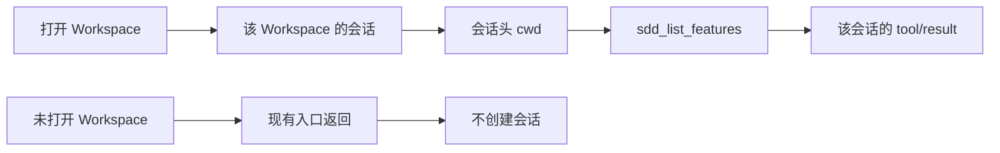

# my-ai-infra SDD 工作台 技术方案

> Feature：999 | 有效需求来源：[spec/PRD.md](../spec/PRD.md) | Profile：standard | 模板：`mai-specs/_templates/TECH_DESIGN.tmpl.md` | 代码基线：当前工作区 | 状态：与当前实现一致

[返回需求简报](../BRIEF.md)

## 需求依据与验收

范围是 PRD 的 FR-01、FR-02、BR-03 和 AC-01 至 AC-06。查询只发生在 DSH Web 已打开 Workspace 的会话中。打开另一个 Workspace 进入的是那个 Workspace 的会话，不改写原会话。Workspace 列表为空时，现有 Web 入口不发起查询，不新增文案。标题为「默认工作区」的首次 Workspace 是已打开的 Workspace。

| 设计假设 | 行为 | 依据 |
| --- | --- | --- |
| DA-1 | 名称匹配的软链接目录不计入、不跟随。`mai-specs` 自身是软链接时也不进入其目标，按「存在但不是目录」处理。 | 满足 AC-05 的读取边界 |
| DA-2 | `mai-specs` 存在但不是目录，或无法读取时，结果文案是「无法读取当前项目的 mai-specs/」。目录不存在仍用「当前项目没有 mai-specs/ 目录」。没有合法 Feature 仍用「未找到 Feature」。 | 仍未写入 PRD 的边界 |

已删除的假设：工具在没有 workspace 记录时返回「当前会话未打开项目」。PRD 的 AC-06 改为现有入口不发起查询。

## 1. 方案概述

### 1.1 设计目标和设计原则

用户在 DSH Web 已打开 Workspace 的当前对话里查询 Feature。工具 `sdd_list_features` 只读**这一次调用所属会话**已记录的 workspace 根，列出 `mai-specs/` 下的合法目录。结果写入该次 `tool/result`。

打开 Workspace B 会创建或复用 B 的会话，并把它显示为当前对话。A 的会话和它已有的 `tool/result` 保持不变。

复用现有工具注册、会话创建和本地 `lstat`。不新增会话事件类型，不新增页面，不把插件放进已发布的 Web 默认组合。不修改 `SessionCommandController.create`、`get` 或 `ensure`。

不做：编辑 Feature、读取 `mai-specs/` 以外的文件内容、跟随软链接、在同一会话里把 workspace 根改成另一个 Workspace、为未打开 Workspace 增加工具文案。

### 1.2 整体架构

Web 打开某个 Workspace 时，Host 把该 Workspace 的路径写进**这个新会话**的会话头。工作目录投影的初始值就是该路径。模型在这个会话里调用工具时，执行对象带着这个会话的 Agent。工具读取投影里的路径。

Workspace 列表为空时，`startSession` 在创建会话之前返回，工具不会执行。已经存在的默认工作区会作为目标 Workspace 创建会话。



### 1.3 关键决策与 Review 索引

| 决策 | 推荐及理由 | 代价与备选 | 待判断事项/确认状态 | 详情 |
| --- | --- | --- | --- | --- |
| 用会话创建区分两个 Workspace | Web 的 `openWorkspace` 调用 `sessions.create({ workspaceId })` 后切换当前会话。原会话的 cwd 和 `tool/result` 不变。这就是 AC-04。 | 不使用 `workingDirectory.set`。`set` 会改同一会话的目录，当前 Web 没有这个操作。 | 需在 Web 上按打开 A、打开 B、回到 A 复看两个会话 | 2.1.2 |
| 未打开 Workspace 时不调用工具 | `startSession` 在没有当前、显式或最近 Workspace 时直接返回，不调用 `sessions.create`。AC-06 由这条入口满足，不由工具文案满足。默认工作区已经在列表中时，新建会话进入它。 | 不改 Host 的缺省 cwd。那会改变所有不传 Workspace 的创建方。 | 客户端测试覆盖空列表不调用 `sessions.create` | 2.1.3 |
| 工具仍读投影原值 | 已打开 Workspace 的会话头里有路径，`get` 也会返回它。`recorded` 在空投影时返回 `null`，不落到 `defaultDirectory`。空投影不读磁盘，也不产生已删除的那句文案。 | 直接用 `get` 会在空投影时读到进程启动目录。 | 已实现于 `packages/session/working-directory/src/index.ts` | 2.3.2 |
| 子项用 `node:fs` 的 `readdir` | `ctx.fs` 没有带链接位的列举。`listDir` 对子项 `realpath` 后再 `stat`，会进入链接目标。 | 只在 `lstat` 确认 `mai-specs` 是真实目录后，对这一层做 `readdir({ withFileTypes: true })`。 | 需用指向外部的链接确认没有 `realpath` | 2.3.1 |
| 插件用本地 patch 挂到 Web | 默认 Web 组合不包含这个实验插件。 | 改已发布 preset 会让所有用户默认带上它。 | patch 插入点在实现时对照当时的 Web 组合 | 2.2 |

## 2. 详细设计方案

### 2.1 核心结构设计

#### 2.1.1 数据结构设计

不新增表，不新增会话事件。工具返回一个 JSON 值，由现有 `tool/result` 持久化：

| 字段 | 类型 | 含义 |
| --- | --- | --- |
| `status` | `list`、`missing`、`empty`、`unreadable` | 本次查询结论 |
| `features` | `{ name, path }[]`，仅 `status` 为 `list` 时出现 | `name` 是目录名；`path` 固定为 `mai-specs/` 加目录名。`missing`、`empty`、`unreadable` 不返回该字段 |

合法目录名匹配 `^[0-9]{3}-[a-z0-9]([a-z0-9-]*[a-z0-9])?$`，slug 最长 64 个字符。排序按三位编号的数值升序。

#### 2.1.2 数据流设计

1. Web 打开 Workspace：`openWorkspace` 经 `connectBlank` 调用 `sessions.create({ workspaceId })`，再 `replaceMain` 显示该会话。
2. Host `SessionCommandController.create` 取 `workspace.path` 作为 cwd。
3. `createAgent` 把该绝对路径写入这个会话的 `meta.cwd`。
4. 投影初始值是 `header.cwd`。本次不调用 `workingDirectory.set`，也不依赖 `workspace-root/change`。
5. 模型在当前会话发起工具调用。`BatchSettlement.commit` 把本次结果追加为这个会话的 `tool/result`。
6. 打开另一个 Workspace 重复第 1 步，得到另一个会话。前一个会话的事件不再写入。

Workspace 列表为空时，`UiWorkspaceService.startSession` 在解析不到目标后返回：有待写入草稿则提示「请先选择工作区」，否则清空主视图。两条都不调用 `sessions.create`，因此没有 Agent，也没有工具调用，不读取 `mai-specs/`。界面已经显示「默认工作区」时，目标是该 Workspace，本段不适用。该目录不存在时，已创建会话的回合由 `working-directory` 报 `directory does not exist`。这不是 CP-01、CP-02，也不是 AC-06。

查询结果：

| 条件 | `status` | 对话中的文字 |
| --- | --- | --- |
| `lstat('mai-specs')` 得到 `undefined` | `missing` | 当前项目没有 mai-specs/ 目录 |
| `lstat` 得到 `symlink`、`file`、`other`，或 `lstat` / `readdir` 抛错 | `unreadable` | 无法读取当前项目的 mai-specs/ |
| 真实目录中没有合法的非链接子目录 | `empty` | 未找到 Feature |
| 有一个或多个合法真实子目录 | `list` | 每项先目录名，再相对路径 |

`missing` 与 `unreadable` 必须分开。不存在是 `undefined`；软链接、普通文件和 IO 失败都不是「不存在」。

#### 2.1.3 接口设计

| 位置 | 接口 | 作用 |
| --- | --- | --- |
| `packages/client/ui-workspace/src/client/navigation.ts` | `openWorkspace` → `sessions.create({ workspaceId })`；`startSession` 在没有 Workspace 时返回 | 有 Workspace 时创建该 Workspace 的会话。没有时不创建会话 |
| `packages/api/session-controller/src/commands.ts` | `SessionCommandController.create` | 有 Workspace 时 `cwd` 为 `workspace.path` |
| `packages/api/session-controller/src/agent.ts` | `createAgent` 的 `meta.cwd` | 会话头记下该 Workspace 的路径 |
| `packages/session/working-directory/src/index.ts` | 投影 `init`；`get`；`ensure` | 投影初始值是 `header.cwd`。`get` 和 `ensure` 在空投影时会换成 `defaultDirectory`，缺省为 `process.cwd()` |
| `packages/skill/tool-skill/src/index.ts` | `defineTool` 与 `ctx.tools.register` | 工具注册和 `execute(args, exec)` 的现有写法 |
| `packages/fs/fs/src/index.ts` | `FileSystem.lstat` | 不跟随最后一层软链接 |
| `packages/fs/fs-local/src/fsio.ts` | `listDirectory` → `realpath` → `stat` | 说明不能用 `listDir` 判断子目录是不是链接 |
| `packages/core/tools/src/batch.ts` | `BatchSettlement.commit` | 每次调用追加自己的 `tool/result` |

`recorded` 原样返回投影。Web 上能执行到工具的会话，其投影是该 Workspace 的路径，不是 `null`。投影为 `null` 时工具不访问文件系统，也不返回已删除的文案；这不是 AC-06。AC-06 在 `startSession` 返回时已经结束。

```ts
recorded(session: Session): string | null {
  return this.workingDirectoryProjectionHandle.stateOf(session)
}
```

实现在 `packages/session/working-directory/src/index.ts`。它不访问磁盘，不把 `null` 换成启动目录。

`output.render` 对 `missing` 和 `empty` 输出 CP-02、CP-01 的整句。工具描述要求模型在此之后只回复该句。宿主不删除模型后来写下的助手正文。`features` 只出现在 `list` 的返回值里。

### 2.2 配置变更

无运行时配置项。目录名规则、CP-01 和 CP-02 是 PRD 的固定文案。DA-2 的不可读文案只属于本设计假设。

插件不进入 `packages/bundle/web-app/presets/cordis.patch.yml`。本地启动使用 patch：

```yaml
- insert:
    - id: tool-sdd-workbench
      name: '@deepseek-ai/dsh-tool-sdd-workbench'
```

启动命令沿用仓库已有形式：`pnpm dsh web --patch <该文件>`。参考现有插入写法：`apps/web/tests/pin-browse-picker.overlay.yml`。

### 2.3 分模块详细设计

#### 2.3.1 工具插件

新增实验包 `packages/experimental/tool-sdd-workbench`。函数插件导出 `name`、`inject`、`apply`，不导出 default。`inject` 为 `['tools', 'fs', 'workingDirectory']`。

`apply` 里 `ctx.tools.register(defineTool(...))`，工具名 `sdd_list_features`，无参数。`execute` 不接收模型传来的路径。

拟新增文件 `packages/experimental/tool-sdd-workbench/src/index.ts` 的执行骨架：

```ts
async execute(_args, exec) {
  const root = ctx.workingDirectory.recorded(exec.agent.session)
  if (root === null) {
    throw new ToolContextUnavailableError('sdd_list_features: the session has no recorded workspace')
  }
  return listFeatures(root, exec.signal)
}
```

Web 的正常调用都有 Agent，也都有 Workspace 路径。`root === null` 只挡住不读启动目录，文案不是产品结果。

`listFeatures` 的分支：

1. `ctx.fs.lstat('mai-specs', { cwd: root }, signal)`。
2. `undefined` → `missing`。
3. `type !== 'directory'`，包括 `symlink` → `unreadable`。不调用 `resolve`、`listDir` 或 `readdir`。
4. 对这个真实目录调用 `node:fs` 的 `readdir(join(root, 'mai-specs'), { withFileTypes: true })`。`Dirent.isSymbolicLink()` 为真的子项跳过。只保留 `isDirectory()` 且名字匹配的项。不再 `stat` 或 `realpath`。
5. 按编号数值排序。`path` 写 `mai-specs/<name>`。
6. 没有保留项 → `empty`。
7. `lstat` 或 `readdir` 抛错 → `unreadable`。

`output.render` 把 `list` 渲染成「目录名换行，相对路径换行」；其余状态渲染成上表的整句。

包需要进入实验包命名例外和 Host tsconfig aggregate。这些是仓库准入任务，不改变查询行为。

#### 2.3.2 工作目录读取

修改 `packages/session/working-directory/src/index.ts`，只增加 `recorded`。不修改 `get`、`ensure`、`set` 和投影的 `init` / `apply`。现有工具继续用 `ensure`。

### 2.4 供评审的代码设计（for review check）

审查重点是三次选择：

- 打开另一个 Workspace 是否只产生另一个会话的 `tool/result`，原会话事件不变。
- `lstat` 看到软链接后是否立即返回，子项是否只看 `Dirent`，没有 `listDir`、`resolve`、`stat` 或 `realpath`。
- 空投影是否不读磁盘，并且没有「当前会话未打开项目」这句文案。

省略了插件的 `package.json`、locale 和实验包名单样板。运行中的 `execute` 在 `packages/experimental/tool-sdd-workbench/src/index.ts`：没有 Agent 或 `recorded` 为 `null` 时抛出 `ToolContextUnavailableError`，不读磁盘。

## 3. 风险评估

| 风险与触发条件 | 影响 | 缓解措施 | 验证方式 |
| --- | --- | --- | --- |
| 验收改用 `workingDirectory.set` | 测的是同一会话换目录，AC-04 的 Web 手势没有被覆盖 | 测试创建两个带各自 Workspace 路径的会话 | 见 AC-04 |
| 无 Workspace 时仍调用 `sessions.create` | 会创建会话并可能读到启动目录，AC-06 失败 | 不改创建逻辑。验收看 `startSession` 是否没有调用 `sessions.create` | 见 AC-06 |
| 子项改用 `listDir` | 外部链接被当成 Feature，AC-05 失败 | 子项只用 `node:fs` 的 `readdir` | 指向 workspace 外的链接 |
| Web 通用卡片不展示 `render` 文本 | 对话里看不到路径或指定文案 | 实现时用一次真实 Web 查询确认 | Web 人工步骤 |

## 4. 兼容性考量

| 端与版本/协议组合 | 是否兼容及依据 | breaking change / 旧端行为 | 是否需配套发版与上线顺序 |
| --- | --- | --- | --- |
| 已有 `workingDirectory.get` / `ensure` 调用方 | 兼容。新方法不改变旧方法 | 无 | 否 |
| 不带 Workspace 的 `session.create` | 兼容。本方案不改缺省 cwd | 那些调用方仍使用启动目录。本工具的 Web 入口不会走到那里 | 否 |
| 未打 patch 的 Web | 兼容。默认组合没有这个工具 | 模型看不到 `sdd_list_features` | 否。使用方启动时加 patch |
| 已有会话日志 | 兼容。不新增事件类型 | 旧 `tool/result` 保持原样 | 否 |

## 5. 任务分解

| 任务 | 关联模块/决策 | 变更文件（新增/修改/删除） | 前置依赖 | 交付物与验收条件 |
| --- | --- | --- | --- | --- |
| 增加 `recorded` | 工作目录读取 | 已修改 `packages/session/working-directory/src/index.ts` 及其测试 | 无 | 已交付。返回投影原值。空投影不访问文件系统 |
| 实现 `sdd_list_features` | 工具插件 | 已新增 `packages/experimental/tool-sdd-workbench/`，并登记实验包与 tsconfig | `recorded` | 已交付。`features` 只在 `list` 时出现。AC-01 至 AC-03、AC-05、DA-1、DA-2 的工具结果由该包测试覆盖 |
| 验证两个 Workspace | FR-02、AC-04 | 同一包的测试，另加 Web 人工步骤 | 上一任务 | 见下方 AC-04 |
| 验证未打开 Workspace | BR-03、AC-06 | 现有 `startSession` 行为的测试 | 无插件也能验入口 | 已由 `workspaces-service.client.spec.ts` 覆盖空列表。默认工作区首屏不在本条 |
| Web 加载 | 配置 | 新增 patch，不改已发布 preset | 插件包可被 Loader 解析 | `dsh web --patch` 后，已打开 Workspace 的对话能调用该工具 |

### AC-01 至 AC-06 的实现与验证

**AC-01。** 已打开 Workspace 的真实目录里放入 `010-beta`、`001-alpha`、`002-gamma`，以及 `_templates`、`README.md`、`ROADMAP.md` 和一个不符合规则的目录。该会话的调用返回 `status: 'list'`，顺序是 `001-alpha`、`002-gamma`、`010-beta`。渲染文本不含被跳过的名字，也不含两句空态文案。

**AC-02。** `mai-specs` 是真实目录，只有 `_templates`、`README.md`、`ROADMAP.md` 和非规则目录。返回 `empty`，渲染文本精确等于「未找到 Feature」。

**AC-03。** workspace 根下没有 `mai-specs`。`lstat` 为 `undefined`。返回 `missing`，渲染文本精确等于「当前项目没有 mai-specs/ 目录」。

**AC-04。** 准备两个目录 A、B，合法 Feature 不同，例如 A 有 `001-alpha`，B 有 `002-beta`。按 Web 的创建方式各建一个会话：A 的会话头 cwd 是 A 的路径，B 的会话头 cwd 是 B 的路径。不调用 `workingDirectory.set`。在 A 的会话调用，`tool/result` 只含 `001-alpha`。在 B 的会话调用，`tool/result` 只含 `002-beta`。断言 A 的会话事件在 B 的调用之后仍然只有 A 的结果。Web 人工步骤是：打开 Workspace A 并查询，打开 Workspace B 并在 B 的会话查询，再回到 A 的原会话，确认之前的结果还在。

**AC-05。** 查询前后比较 workspace 的目录项和文件内容，确认没有增删改。`mai-specs` 本身是指向别处的软链接时，结果是 `unreadable`，记录里只有一次 `lstat`。真实目录中有一个指向 workspace 外的合规子目录链接时，结果不包含它，记录里没有该目标的 `realpath`、`stat` 或文件读取。

**AC-06。** DSH Web 的 Workspace 列表为空。使用现有入口新建会话或请求列出 Feature。`startSession` 不调用 `sessions.create`。不出现 Feature 列表、CP-01 或 CP-02，也不读取 `mai-specs/`。不检查工具是否返回某一句文案，因为查询没有开始。已经显示「默认工作区」时不使用本条。

## 仍需验证的假设

- Web 从 Workspace 创建的会话，其 `header.cwd` 等于 `workspace.path`。这由 `openWorkspace` 和 `SessionCommandController.create` 的源码推出，尚未在运行中的 Web 里复测。
- 通用工具卡片会把 `output.render` 的文本显示在当前对话。若不会，实现时改用卡片实际展示的结果字段，文案保持不变。
- `node:fs` 的 `readdir({ withFileTypes: true })` 对目录链接给出 `isSymbolicLink() === true`，并且不打开目标。这是 Node 的目录项语义，实现时用指向外部的链接确认。
