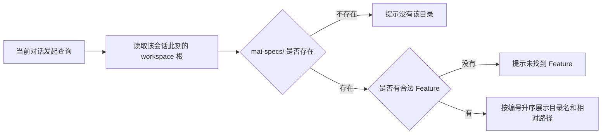

# PRD：my-ai-infra SDD 工作台

> 状态：草稿 | 负责人：待填 | Profile：standard

[返回需求简报](../BRIEF.md)

## 1. 背景与目标（Why）

- **背景/痛点**：在 DSH Web 中打开使用 my-ai-infra 的项目后，用户无法从当前对话直接知道 `mai-specs/` 里有哪些 SDD Feature，以及它们在项目中的位置。
- **目标**：用户在 DSH Web 已打开 Workspace 的当前对话中，只读看到该会话 workspace 根目录下的 Feature 目录名和项目相对路径。未打开 Workspace 时不发起查询。标题为「默认工作区」的首次 Workspace 是已打开的 Workspace，不走这条未打开路径。

## 2. 用户与场景（Who / When）

| 用户故事 ID | 目标用户 | 触发场景 | 用户故事：作为…我希望…以便… | 关联需求 |
|---|---|---|---|---|
| US-01 | 在 DSH Web 中查看项目的人 | DSH Web 已打开一个 Workspace，当前对话属于该 Workspace 的会话 | 作为使用者，我希望在当前对话中查询 SDD Feature，以便知道有哪些 Feature 以及它们的相对路径。 | FR-01 |

## 3. 总体业务流程

### BF-01：在当前对话查询 Feature

**参与者与起止**：使用者在 DSH Web 已打开 Workspace 的当前对话中发起查询；查询结束时，同一条对话里出现列表或一条明确提示。不打开新页面。这一次查询不切换会话。



**流程说明**：查询只读该 Workspace 根下的 `mai-specs/` 直属目录。合法 Feature 按 BR-01 识别，按 BR-02 排序，按 FR-01 展示。其余直属条目跳过，不单独报错。

### BF-02：打开另一个 Workspace 后查询

**参与者与起止**：使用者已经在 Workspace A 的会话里看到查询结果。打开 Workspace B 后，在 B 的会话中查询；再回到 A 的原会话时，A 的原结果仍在。


**流程说明**：打开 Workspace B 进入的是 B 的会话，不改写 A 的会话。B 的查询只读 B 的 workspace 根。A 的原会话保留查询当时的结果。

### BF-03：未打开 Workspace

**参与者与起止**：DSH Web 没有已打开的 Workspace。使用者使用现有入口准备对话或请求列出 Feature；流程在入口处结束，不发起查询。


**流程说明**：未打开是指没有当前、显式或最近 Workspace。这时 `startSession` 在 `sessions.create` 之前返回：有待写入草稿时提示「请先选择工作区」，否则清空主视图。不出现 Feature 列表、CP-01 或 CP-02，不读取 `mai-specs/`。本版不为该入口新增文案。首次使用创建的「默认工作区」已经在 Workspace 列表中，新建会话会进入它，因此不属于本流程。

## 4. 功能需求（What）

### 4.1 新增需求

| 需求编号 | 触发条件 | 输入 | 预期行为 | 输出/结果 | 关联需求编号 |
|---|---|---|---|---|---|
| FR-01 | 用户在 DSH Web 已打开 Workspace 的当前对话中请求列出 SDD Feature | 发起查询时，该会话所绑定的 workspace 根目录 | 只读检查该根目录下的 `mai-specs/`。不创建、不修改、不删除任何文件。不读取该目录以外的内容。 | 结果出现在同一条对话中。有合法 Feature 时逐项展示目录名和项目相对路径；否则展示 CP-01 或 CP-02。 | US-01、BR-01、BR-02、BR-03 |
| FR-02 | 用户已在 Workspace A 的会话中看到查询结果，随后在 DSH Web 打开 Workspace B 并查询，再回到 A | A 的原会话，以及 B 的会话和 B 的 workspace 根 | 在 B 的会话中按 B 的根目录执行 FR-01。不改写 A 的原会话。 | B 的该次结果只反映 B。回到 A 的原会话后，A 之前的查询结果仍保留。 | FR-01、BR-03 |

### 4.2 变更需求

无。

## 5. UI 视觉与交互（按需）

### UI-01：当前对话中的查询结果

**设计依据**：拟议方案，覆盖本次结果区。未提供设计稿，以下线框未经过渲染器检查。沿用 DSH Web 当前对话展示结果的方式，不新增独立页面。

```text
当前对话
用户：列出这个项目的 SDD Feature
结果：
  001-alpha
  mai-specs/001-alpha
  010-beta
  mai-specs/010-beta
```

| 页面区域/控件 | 新增/变更 | 对照设计的功能与交互说明 | 关联需求 |
|---|---|---|---|
| 当前对话结果 | 新增 | 每项直接可见两个字段：Feature 目录名，以及相对 workspace 根的路径。路径使用 `/`，不以 `/` 开头，不含 `..`。用户不需要打开另一页或另一会话才能看到这两项。 | FR-01 |
| 空结果与缺目录 | 新增 | 两种状态各使用一条最终文案，不附加未约定的解释。 | CP-01、CP-02 |

**状态与反馈**：

- 有合法 Feature：展示列表，不显示 CP-01 或 CP-02。
- `mai-specs/` 存在但没有合法 Feature：显示 CP-01。
- `mai-specs/` 不存在：显示 CP-02。
- 加载、禁用和权限失败没有已确认文案，不在本版承诺内。查询不提供编辑、删除或新建入口。
- 未打开 Workspace：Workspace 列表为空时，现有入口不发起查询，本功能不展示列表、CP-01 或 CP-02，也不新增文案。已经显示的「默认工作区」不在这条里。

## 6. 业务规则与约束（Rules）

| 规则 ID | 业务规则、状态流转、权限或数据约束 | 关联需求 |
|---|---|---|
| BR-01 | 只承认 `mai-specs/` 的直属子目录，且目录名匹配 `^[0-9]{3}-[a-z0-9]([a-z0-9-]*[a-z0-9])?$`，slug 最长 64 个字符。文件、更深层目录、`_templates`、`README.md`、`ROADMAP.md` 以及其他不匹配的直属条目都跳过。名称匹配的软链接不计入，也不跟随。 | FR-01 |
| BR-02 | 多个合法 Feature 按三位编号的数值升序排列。编号相同的目录名不会同时存在。 | FR-01 |
| BR-03 | 查询只发生在 DSH Web 已打开 Workspace 的会话中。「当前项目」是该会话在查询当时的 workspace 根目录，读取范围只限该根下的 `mai-specs/`。没有当前、显式或最近 Workspace 时，现有 Web 入口不调用 `sessions.create`。标题为「默认工作区」、目录为 Documents 下 `deepseek-harness/default-workspace` 的首次 Workspace 是已打开的 Workspace。 | FR-01、FR-02 |

| 非功能 ID | 性能、可靠性、安全或可访问性要求 | 适用条件与验证口径 |
|---|---|---|
| NFR-01 | 查询是只读的，不改变 workspace 内任何文件的内容、名称或存在性。 | 查询前后比较 `mai-specs/` 与 workspace 根目录的文件变化 |

## 7. 范围与边界（Scope）

- **包含**：FR-01、FR-02。在已打开 Workspace 的当前对话中列出合法 Feature，或给出 CP-01、CP-02。打开另一个 Workspace 后，在那个 Workspace 的会话中查询，并保留原会话的结果。
- **不包含**：编辑、创建或删除 Feature；展示 Feature 正文；搜索文件内容；读取 `mai-specs/` 以外的路径；固定查询口令；独立导航页面。未打开 Workspace 时的新文案或新查询。在同一会话内把 workspace 根改成另一个 Workspace。
- **依赖**：DSH Web 已打开 Workspace 的当前会话，以及该会话在查询当时的 workspace 根目录。

## 8. 研发资源（按需）

| 资源 ID | 类型 | 实际链接/路径或本文位置 | 用途/关联需求 | 确认与核验状态 |
|---|---|---|---|---|
| RS-01 | 线框 | 本文 UI-01 | 结果区字段 | 拟议方案，未核验设计稿 |

### 最终文案（按需）

| 文案 ID | 位置/触发状态 | 最终文字 | 变量与格式规则 |
|---|---|---|---|
| CP-01 | 当前对话的工具结果；`mai-specs/` 存在但没有合法 Feature | 未找到 Feature | 工具结果整句精确匹配。工具描述要求模型之后只回复这句。宿主不删除模型后来写下的句子 |
| CP-02 | 当前对话的工具结果；workspace 根下不存在 `mai-specs/` | 当前项目没有 mai-specs/ 目录 | 工具结果整句精确匹配。工具描述要求模型之后只回复这句。宿主不删除模型后来写下的句子 |

列表项没有额外固定句子。目录名原样展示；相对路径为 `mai-specs/` 加上目录名。

## 9. 验收标准（Acceptance Criteria）

### AC-01：多个合法 Feature 按编号展示并跳过其他条目

**关联**：FR-01、BR-01、BR-02

- **Given**：DSH Web 已打开一个 Workspace。该会话的 workspace 根下存在 `mai-specs/010-beta/`、`mai-specs/001-alpha/`、`mai-specs/002-gamma/`，以及 `_templates/`、`README.md`、`ROADMAP.md` 和一个不匹配 `NNN-slug` 的直属目录。
- **When**：用户在该会话的当前对话中查询 SDD Feature。
- **Then**：同一条对话按 `001-alpha`、`002-gamma`、`010-beta` 的顺序展示三项。每一项都能看到目录名和相对路径 `mai-specs/001-alpha`、`mai-specs/002-gamma`、`mai-specs/010-beta`。结果中不出现被跳过的条目。不出现 CP-01 或 CP-02。
- **验证方式**：人工步骤，在 DSH Web 当前对话观察结果顺序和字段。

### AC-02：存在 mai-specs 但没有合法 Feature

**关联**：FR-01、BR-01、CP-01

- **Given**：DSH Web 已打开一个 Workspace。该 workspace 根下存在 `mai-specs/`，其中只有 `_templates/`、`README.md`、`ROADMAP.md` 或不匹配规则的条目。
- **When**：用户在当前对话中查询 SDD Feature。
- **Then**：同一次工具结果的文本精确为「未找到 Feature」，不显示 Feature 列表。工具描述要求模型之后的回复只有这句。宿主不删除模型后来写下的句子。
- **验证方式**：工具测试核对结果文本。页面观察记录指定模型是否只回复这句，该观察不是宿主保证。

### AC-03：不存在 mai-specs

**关联**：FR-01、CP-02

- **Given**：DSH Web 已打开一个 Workspace。该会话的 workspace 根下没有 `mai-specs/`。
- **When**：用户在当前对话中查询 SDD Feature。
- **Then**：同一次工具结果的文本精确为「当前项目没有 mai-specs/ 目录」，不显示 Feature 列表。工具描述要求模型之后的回复只有这句。宿主不删除模型后来写下的句子。
- **验证方式**：工具测试核对结果文本。页面观察记录指定模型是否只回复这句，该观察不是宿主保证。

### AC-04：打开另一个 Workspace 后分别查询

**关联**：FR-02、BR-03

- **Given**：Workspace A 和 Workspace B 都可以在 DSH Web 打开，两者的合法 Feature 不同。
- **When**：在 DSH Web 打开 Workspace A 并查询。再打开 Workspace B，进入 B 的会话并查询。然后回到 A 的原会话。
- **Then**：A 的会话只显示 A 的 Feature。B 的该次结果只显示 B 的 Feature，顺序符合 BR-02，不包含仅存在于 A 的 Feature。回到 A 的原会话后，之前的查询结果仍保留。
- **验证方式**：人工步骤，按上述顺序在 DSH Web 操作，并分别查看 A、B 两个会话。

### AC-05：查询不改动文件

**关联**：NFR-01、BR-03

- **Given**：DSH Web 已打开一个 Workspace。该 workspace 根及其 `mai-specs/` 处于任一 AC-01、AC-02 或 AC-03 的前置状态。
- **When**：用户完成一次查询。
- **Then**：workspace 内文件的内容、名称和存在性与查询前一致。查询没有读取 `mai-specs/` 以外的路径来生成列表。
- **验证方式**：人工步骤，查询前后比较 workspace 文件；列表中的路径均以 `mai-specs/` 开头。

### AC-06：未打开 Workspace 时不发起查询

**关联**：BR-03

- **Given**：DSH Web 的 Workspace 列表为空。没有当前会话所属的 Workspace，没有显式 Workspace，也没有最近 Workspace。界面已经显示「默认工作区」时不使用本条。
- **When**：用户使用现有 Web 入口新建会话，或在该入口请求列出 SDD Feature。
- **Then**：`startSession` 不调用 `sessions.create`。没有待写入草稿时清空主视图；有待写入草稿时提示「请先选择工作区」。不出现 Feature 列表、CP-01 或 CP-02，也不读取 `mai-specs/`。
- **验证方式**：`packages/client/ui-workspace/tests/workspaces-service.client.spec.ts` 中无 Workspace 时不调用 `sessions.create` 的用例。

## 待确认事项

| 问题/假设 | 来源 | 影响的编号/范围 | 是否阻塞 | 决策人/状态 |
|---|---|---|---|---|
| `NNN-slug` 采用本项目既有目录规则：三位数字、连字符、小写 slug，slug 最长 64 个字符。 | 已确认「只识别 NNN-slug」；字符约束来自现有 `mai-specs` 编号规则 | BR-01、AC-01 | 否 | 已采用；若要放宽字符或位数，需改 BR-01 |
| 名称匹配的软链接目录不计入，也不跟随。 | 本次未单独确认 | BR-01 | 否 | 假设，待确认 |
| `mai-specs` 存在但不是目录，或目录不可读时，本版不另设文案。 | 本次未确认 | FR-01 | 否 | 待确认 |
| 未打开 Workspace 时不另设文案。现有 Web 入口不发起查询。 | 本轮按设计评审确认 | BR-03、AC-06 | 否 | 已确认 |
| 「默认工作区」是已打开的 Workspace。它的目录是 Documents 下的 `deepseek-harness/default-workspace`。只有 Workspace 列表为空时才走 AC-06。 | 2026-11-24 按批改确认。2026-11-22 的 TC-06 在默认工作区首屏发问，测的不是未打开 | BR-03、AC-06 | 否 | 已确认 |
| CP-01、CP-02 的精确整句由工具结果保证。模型之后只回复该句是工具描述中的指令，宿主不截断后续正文。 | 2026-11-24 按批改确认 | CP-01、CP-02、AC-02、AC-03 | 否 | 已确认 |

已确认并写入正文、不再开放的决定：只识别直属 `NNN-slug` 目录并按编号升序；结果在当前对话展示目录名和相对路径；查询只发生在已打开 Workspace 的会话中，当前项目是该会话当时的 workspace 根。打开另一个 Workspace 是进入那个 Workspace 的会话，不改写原会话。未打开 Workspace 时不发起查询。

## 变更记录（维护时）

| 日期 | 变更及依据 | 影响的编号/范围 |
|---|---|---|
| 2026-11-22 | 首版。依据 Feature 999 的 BRIEF、上下文，以及本轮确认的三条产品决定。 | FR-01、FR-02、AC-01 至 AC-05 |
| 2026-11-22 | 按设计评审修订。AC-04 改为打开另一个 Workspace 的会话。查询限于已打开的 Workspace；未打开时现有入口不发起查询。 | FR-02、BR-03、BF-02、BF-03、AC-04、AC-06 |
| 2026-11-24 | 确认默认工作区是已打开的 Workspace。AC-06 只覆盖 Workspace 列表为空。CP-01、CP-02 的整句保证停在工具结果，模型后续正文不由宿主截断。 | BR-03、BF-03、CP-01、CP-02、AC-02、AC-03、AC-06 |
